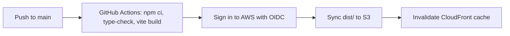

# My Portfolio

A personal portfolio for showing projects, internships and certifications to recruiters. It is a static site: React and Vite build it into plain files, GitHub Actions publishes them to Amazon S3, and CloudFront serves them.

## Features

- A hero with a photo, a short introduction and a résumé download
- Project cards with a screenshot viewer (arrows, full-size view, keyboard support), captions, a live demo link and a GitHub link
- Experience, certifications, skills and a short about section
- A collapsible footer panel that explains how the site itself is deployed
- Light and dark themes, with the choice remembered between visits
- A canvas network background with three depth layers, signals that hop between nodes, and a cursor that acts as a node
- Works on phones, respects `prefers-reduced-motion`, and keeps keyboard focus visible

## Tech stack

| Area    | Tools                                                                   |
| ------- | ----------------------------------------------------------------------- |
| UI      | React 19, TypeScript                                                    |
| Build   | Vite 7                                                                  |
| Styling | Tailwind CSS 4                                                          |
| Motion  | framer-motion (scroll reveals), a hand-written canvas loop (background) |
| Icons   | lucide-react                                                            |
| Hosting | Amazon S3 and CloudFront                                                |
| CI/CD   | GitHub Actions with AWS OIDC                                            |

## Project structure

```
.
├── .github/workflows/deploy.yaml   # build and deploy on every push to main
├── public/
│   ├── Jaden-Mimura-Resume.pdf     # the résumé download
│   ├── jaden.jpg                   # hero photo
│   └── projects/                   # project screenshots (.webp)
├── src/
│   ├── components/                 # Hero, Projects, ProjectGallery, Experience, About, Footer, ...
│   ├── data/site.ts                # all of the site's content
│   ├── hooks/useTheme.ts           # light and dark theme
│   └── index.css                   # colour tokens and Tailwind setup
└── vite.config.ts
```

## Run it locally

You need Node.js 20.19 or newer.

```bash
npm install
npm run dev        # http://localhost:5173
```

```bash
npm run build      # type-check, then build into dist/
npm run preview    # serve the production build at http://localhost:4173
```

## Edit the content

Nearly everything you read on the site comes from `src/data/site.ts`.

- **Introduction, about text, skills, links:** the `site` object.
- **Experience and certifications:** the `experience` and `certifications` lists.
- **Projects:** the `projects` list. Each project takes a title, description, tags, year, and optional `live`, `repo`, `hosting` and `images`.
- **Screenshots:** put the files in `public/projects/` (about 1600 px wide as `.webp`, plus a 640 px `-thumb` copy), then add one entry per image to the project's `images` list with a `title` and a one-line `caption`. The card keeps a fixed-size preview, so any number of screenshots works.
- **Résumé:** replace `public/Jaden-Mimura-Resume.pdf` and keep the file name.
- **Colours and theme:** the CSS variables at the top of `src/index.css`. The background reads `--line`, `--node`, `--primary` and `--accent-glow`, so it follows the theme.
- **Background density and behaviour:** the constants at the top of `src/components/NetworkBackground.tsx` (`LAYERS`, `MAX_SIGNALS`, `CURSOR_RADIUS`).

## Deployment

Every push to `main` runs `.github/workflows/deploy.yaml`. You can also run it by hand from the Actions tab.



The workflow uses short-lived credentials from AWS OIDC, so no AWS access keys are stored in GitHub.

### GitHub settings the workflow needs

Add these under Settings, then Secrets and variables, then Actions.

| Name                         | Type     | What it is                                 |
| ---------------------------- | -------- | ------------------------------------------ |
| `AWS_ROLE_ARN`               | Secret   | ARN of the IAM role GitHub Actions assumes |
| `AWS_REGION`                 | Variable | Region of the S3 bucket                    |
| `S3_BUCKET`                  | Variable | Name of the bucket that holds the site     |
| `CLOUDFRONT_DISTRIBUTION_ID` | Variable | ID of the CloudFront distribution          |

### One-time AWS setup

1. Create an S3 bucket for the site.
2. Create a CloudFront distribution with that bucket as the origin and `index.html` as the default root object. Use origin access control so the bucket can stay private.
3. In IAM, add an OIDC identity provider for `token.actions.githubusercontent.com`.
4. Create an IAM role that GitHub can assume through that provider. In its trust policy, limit the `sub` claim to this repository and branch, for example `repo:OWNER/REPO:ref:refs/heads/main`.
5. Give the role only what the workflow uses: `s3:ListBucket` on the bucket, `s3:PutObject` and `s3:DeleteObject` on the objects in it, and `cloudfront:CreateInvalidation` on the distribution.
6. Add the secret and variables from the table above.

The "How this site is deployed" panel in the footer mirrors the workflow. If you change the workflow, update the steps in `src/components/Footer.tsx` to match. The links in that panel come from `deployment.repo` in `src/data/site.ts`.

## Performance and accessibility notes

- The production build is about 385 kB of JavaScript (123 kB gzipped) and 24 kB of CSS (5.6 kB gzipped). Most of the JavaScript is React and framer-motion.
- Screenshots are `.webp`, lazy-loaded, and shown as small thumbnails until opened.
- The background caps its pixel ratio at 2 and re-wires links from live distances. It draws links in batches rather than one at a time.
- The cards and navigation use no `backdrop-filter`. Blurring a moving canvas on every scroll frame caused visible stutter, so the cards are slightly more opaque instead.
- With reduced motion turned on, the background draws one still frame and the scroll reveals are skipped.
- The screenshot viewer closes with Escape, switches images with the arrow keys, and returns focus to the card when it closes.

## Credits

- Background inspiration [Network Topology Mesh Graphic]
- Icons from [Lucide](https://lucide.dev/icons/)
- Claude
